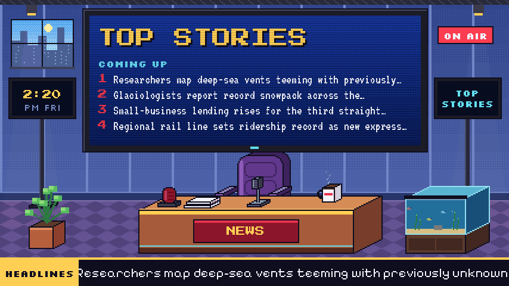

# Anchorless

[](https://github.com/GabeBecker2048/anchorless/releases)
[](https://github.com/GabeBecker2048/anchorless/pkgs/container/anchorless)
[](pyproject.toml)
[](LICENSE)
[](https://github.com/GabeBecker2048/anchorless/actions/workflows/test.yml)



<sub>Recorded from the real playout, sped up. The headlines and outlets are made up.</sub>

**News without the anchor.** Anchorless turns news headlines into a 24/7 TV
channel you can add to Jellyfin, Plex, Channels DVR or any IPTV player: an empty
pixel-art news set where the news plays on the big screen behind a desk nobody
sits at - with a headline crawl, background music and breaking-news alerts.

- Pulls headlines from public RSS feeds, groups the same story across outlets,
  and builds a rundown (top stories, local, national, world, business).
- Breaking news interrupts the rundown when many outlets pick a story up at once.
- Two looks: the pixel-art **Studio**, or **Classic** cable-news pages (light, dark,
  or switching with the time of day).
- Lightweight: no browser - Python draws the frames, ffmpeg encodes them, and
  nothing runs while nobody is watching.
- Watch it in a browser too, and change its settings there (optional, password
  protected).

## Quick start

With Docker:

```sh
mkdir anchorless && cd anchorless && mkdir config data
base=https://raw.githubusercontent.com/GabeBecker2048/anchorless/main
curl -fsSL -o docker-compose.yml $base/deploy/docker-compose.example.yml   # then adjust the music folder and encoder
curl -fsSL -o config/config.toml $base/config.example.toml
docker compose up -d
```

Or without Docker (needs ffmpeg and [uv](https://docs.astral.sh/uv/)):

```sh
git clone https://github.com/GabeBecker2048/anchorless.git && cd anchorless
cp config.example.toml config.toml
uv run anchorless serve
```

Then open `http://<host>:9798/` to watch in a browser, or add it to your TV
server as an M3U tuner (`http://<host>:9798/playlist.m3u`) with an XMLTV guide
(`http://<host>:9798/guide.xml`).

## More

- [The guide](docs/guide.md): Jellyfin setup, themes and channels, the settings
  page, hosting publicly, and configuration
- [`config.example.toml`](config.example.toml): every setting, explained
- [SECURITY.md](SECURITY.md): reporting a vulnerability
- [CHANGELOG.md](CHANGELOG.md): what changed in each release

Anchorless doesn't include music: point it at a folder of MP3s you have the
right to play (`[audio] music_dir`), or it runs with just its own sound effects.

## License

MIT. The bundled fonts are under the SIL Open Font License and the bundled
[mpegts.js](https://github.com/xqq/mpegts.js) player under Apache 2.0. Headlines
belong to their outlets; see [Sources and fair use](docs/guide.md#sources-and-fair-use).
