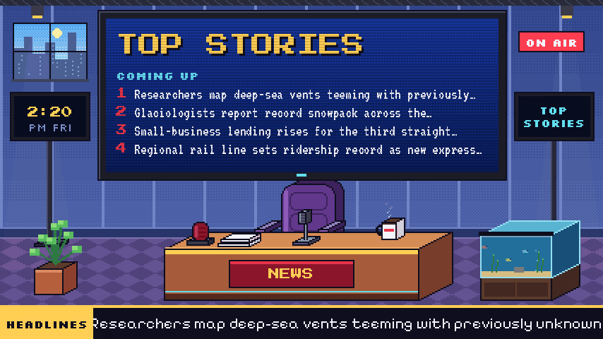

# News without the anchor
{: .home-title }

Anchorless turns public news headlines into a 24/7 TV channel. Add it to
Jellyfin, Plex, Channels DVR or any IPTV player, or watch it in a browser: an
empty pixel-art news set where the news plays on the big screen behind a desk
nobody sits at, with a headline crawl, background music and breaking-news alerts.
{: .lead }

## Start here

  <a href="install.html"><b>1. Install</b>Docker or pip, running in a few minutes.</a>
  <a href="watching.html"><b>2. Watch it</b>In a browser, or as a channel in Jellyfin, Plex and friends.</a>
  <a href="local-news.html"><b>3. Local news</b>Add your town's outlets for a local segment and local alerts.</a>
  <a href="configuration.html"><b>Every setting</b>The full configuration reference.</a>

## What it does

- **Pulls headlines from public RSS feeds**, groups the same story across
  outlets, and builds a rundown: top stories, local, national, world, business.
- **Breaks in with breaking news** when many outlets pick a story up at once.
- **Two looks:** the pixel-art **Studio**, or **Classic** cable-news pages
  (light, dark, or switching with the time of day). Run several channels at once.
- **Lightweight:** no browser inside. Nothing runs while nobody is watching.
- **A settings page** in the browser (optional, password protected) that edits
  the same config file you can edit by hand.

## What you need

- **Docker**, or **Python 3.12+** with [ffmpeg](https://ffmpeg.org/download.html).
- About 30% of one CPU core for each channel while someone is watching it
  (none while nobody is). The container image runs on amd64 and arm64.
- Optionally, a folder of MP3s to play underneath. Anchorless ships no music.

## Getting help

- Something not working? See [Troubleshooting](troubleshooting.html).
- Found a bug or have an idea? [Open an issue](https://github.com/GabeBecker2048/anchorless/issues).
- Found a security problem? Report it privately, see [SECURITY.md](https://github.com/GabeBecker2048/anchorless/blob/main/SECURITY.md).
